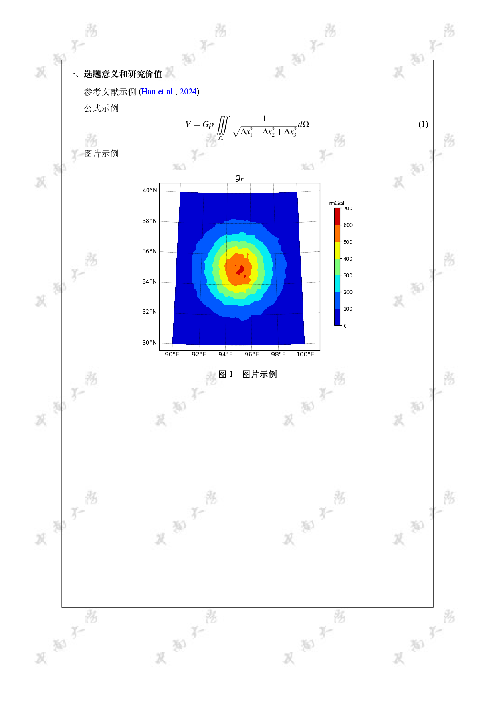

# 中南大学研究生学位论文开题报告 LaTeX 模板

本模板参照中南大学《研究生学位论文开题报告》Word 表格排版。默认示例共 9 页，包括封面、七个正文栏目和评审签字页。各栏内容较长时可自动续页。

## 正文预览

下图是示例 PDF 的第 2 页，即正文第一栏「选题意义和研究价值」。可以看到正文表框、水印，以及文献引用、编号公式和插图的排版。点击图片可查看原图。

[](docs/proposal-body.png)

## 编译环境

| 设置 | 选择 |
| --- | --- |
| 主文件 | `Proposal.tex` |
| 编译器 | **XeLaTeX** |
| 参考文献工具 | BibTeX |
| 输出文件 | `Proposal.pdf` |

**在 Overleaf 上**，上传完整仓库文件，将主文件设为 `Proposal.tex`，在编译器选项中选择 **XeLaTeX**，然后重新编译。模板通过 `fontspec` 和 `xeCJK` 加载中西文字体，pdfLaTeX 无法直接编译这份源码。

**在本地**，可使用完整版 TeX Live（macOS 可安装 MacTeX）。在仓库根目录运行以下命令，`latexmk` 会调用 XeLaTeX 和 BibTeX，生成 PDF 并解析文献引用。示例已在 TeX Live 2026 上验证。

```bash
latexmk -xelatex Proposal.tex
```

## 填写说明

1. 在 `Proposal.tex` 中修改姓名、学号、论文题目、课题来源、攻读学位、导师、专业、二级单位和日期，然后替换正文示例。
2. 评审表默认留空，便于手写。若需要预填，`\ReviewerOne` 对应组长，`\ReviewerTwo` 至 `\ReviewerSeven` 对应六位成员，`\Secretary` 对应秘书。三个参数依次为姓名、职称、工作单位。
3. 将参考文献写入 `ref.bib`，在正文中使用对应的引用键。

中文优先使用宋体（SimSun），缺少该字体时使用 TeX Live 附带的 Fandol 宋体。西文优先使用 Times New Roman，缺少时使用 TeX Gyre Termes。

## 致谢

本模板基于以下工作开发。

- 钟乙源的[中南大学开题报告模板](https://github.com/zhong-yy/CSU_Thesis_Proposal)
- 张臻的[西北工业大学开题报告模板](https://github.com/zzhang1987/NPUResearchProposal)
- 刘亮的[新版中南大学开题报告模板](https://github.com/gisliuliang/New_CSU_Thesis_Proposal)
